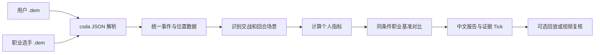

# Demo Player Coach 独立分析工具计划

## 1. 项目定位

状态：仅完成方案设计，尚未开始实现。

目标是在仓库根目录维护一个独立工具 `demo-player-coach/`，读取用户与职业选手的 CS2 `.dem`，针对指定玩家生成可复核的操作分析、同条件职业基准对比和训练建议。

独立性约束：

- 不导入 `../src/**`，不接入 Electron、Redux、WebSocket 或主程序界面。
- 不访问或修改 CS Demo Manager 的 PostgreSQL 数据库。
- 不修改根目录 `package.json`、`pnpm-workspace.yaml`、构建脚本和应用设置。
- 使用自己的配置、依赖、缓存、测试与输出目录。
- 原始 Demo 默认只读，不移动、不改名、不上传。
- Demo 解析器路径通过配置注入。开发初期可复用 `../static/csda.exe`，发布独立工具时改为自带或由用户指定。

## 2. 核心原则

1. 用户 Demo 和职业选手 Demo 必须经过同一套解析、清洗和指标计算流程。
2. 只比较同地图、同阵营、相近职责、武器和回合场景，避免把不同任务的数据直接混在一起。
3. 每条结论必须带样本数、对比基准、相关 Tick 和置信度。
4. 规则与统计先产生事实，报告生成层只负责解释，不能虚构 Demo 中不存在的操作。
5. 无法仅凭 Demo 可靠判断的内容必须标为“需画面复核”，不能输出确定性结论。
6. 在线网页统计只用于补充选手、赛事和比赛元数据；职业操作基准以公开职业比赛 Demo 的解析结果为准。

## 3. 首期范围

### 输入

- 用户 Demo 目录，例如 `D:\Game\CS2\5EDemocache`。
- 目标玩家：优先使用 SteamID64，昵称仅作为辅助匹配条件。
- 职业基准 Demo 目录及选手清单。
- 可选筛选：地图、阵营、武器、回合、日期、比赛来源、对比选手和职责。

### 输出

每次分析生成独立目录：

```text
output/<run-id>/
  report.md
  report.json
  metrics.csv
  evidence.csv
  charts/
  clips.json
```

- `report.md`：供人阅读的中文报告。
- `report.json`：结构化结论，便于后续接 UI 或其他模型。
- `metrics.csv`：用户与职业基准指标。
- `evidence.csv`：每条结论对应的 Demo、回合、Tick 和事件。
- `charts/`：分布图、趋势图、位置热图等。
- `clips.json`：建议回看的 Tick 区间，不强制生成视频。

### 首期不做

- 不训练识别玩家水平的黑盒模型。
- 不把普通网页文章中的经验值当职业基准。
- 不自动绕过登录、验证码或站点访问限制抓取 Demo。
- 不承诺从 GOTV Demo 精确还原原始键鼠输入。
- 不在没有可见性计算时声称测得了精确反应时间。

## 4. 数据流



解析时使用 `csda` 的 JSON 输出，并开启位置数据。解析结果按 Demo 校验和缓存，重复分析时不再次解析。

## 5. 建议目录结构

```text
demo-player-coach/
  PLAN.md
  README.md
  pyproject.toml
  config.example.yaml
  src/demo_player_coach/
    cli.py
    config.py
    models.py
    parser/
      csda.py
      normalize.py
    analysis/
      episodes.py
      mechanics.py
      positioning.py
      utility.py
      decisions.py
      confidence.py
    benchmark/
      catalog.py
      filters.py
      aggregate.py
    report/
      build_report.py
      charts.py
      templates/
    video/
      clips_manifest.py
  tests/
    fixtures/
  data/
    user-demos/
    pro-demos/
    catalog/
    cache/
  output/
```

其中 `data/`、`output/` 和本地配置应加入该目录自己的 `.gitignore`。原始 Demo 也可以保留在外部目录，配置中只保存绝对路径。

建议使用 Python 3.12 和独立 `pyproject.toml`：Python 更适合统计、数据帧、图表和 Markdown 报告；解析仍调用现有的跨平台 `csda` 可执行文件。是否采用 `uv` 在实现阶段根据本机环境确认。

## 6. 玩家和职业样本目录

使用显式清单管理身份，避免昵称变化或同名误匹配：

```yaml
players:
  user:
    steam_id: '7656119...'
    aliases: ['MyName']
  references:
    - steam_id: '7656119...'
      name: 'pro-player'
      roles: ['rifler', 'entry']
      maps: ['de_mirage', 'de_inferno']
```

职业基准数据来源优先级：

1. 用户手动放入 `data/pro-demos/` 的公开赛事 Demo，并记录比赛链接、赛事、日期和地图。
2. 有授权凭据时接入 FACEIT Data API；其比赛响应可提供 `demo_url`，私有下载资源需要有相应权限的下载接口。
3. HLTV 等赛事页面仅作为人工发现 Demo 的入口。首期不实现脆弱的页面抓取器，也不假设存在稳定官方 API。

参考资料：

- [FACEIT Data API](https://docs.faceit.com/docs/data-api/data/)
- [FACEIT Downloads API](https://docs.faceit.com/getting-started/Guides/download-api/)
- [HLTV 比赛列表](https://www.hltv.org/matches)

## 7. 操作场景建模

不能只比较整场 K/D。分析器需要先把数据拆成可比较的操作片段：

- 回合阶段：出生、默认控图、爆弹、进点、守点、回防、残局和保枪。
- 交战类型：主动首接触、被动接触、补枪、被补枪、多目标转火和穿烟交战。
- 职责：首攻、第二身位、自由人、支援、主狙和防守锚点。
- 条件：地图区域、T/CT、武器、护甲、人数差、经济类型和是否持有道具。

首期场景识别采用透明规则，每个片段保留规则命中原因。职责允许用户在配置中指定；自动推断只能作为建议，不能覆盖显式配置。

## 8. 指标与置信度

### A. 可直接量化，优先实现

- 首杀尝试、首杀成功率和首死率。
- 击杀、死亡、助攻、伤害、爆头、交换击杀和被交换情况。
- 首次伤害 Tick、开枪 Tick、命中部位和每次交战的开火次数。
- 开火时水平速度、停稳比例和开枪前减速时间，用于近似急停质量。
- 单发、短点射、长连发分布，以及相邻射击间隔。
- 不同距离和武器下的伤害效率。
- 闪光次数、致盲人数、致盲时长、HE 伤害、烟雾与燃烧弹使用结果。
- 首接触后的存活时间、完成击杀所需时间和多杀转化。
- 每张地图、阵营、回合阶段的位置占用率和移动路线。

### B. 需要推断，报告标中等置信度

- 急停失败：基于开火时速度阈值及此前速度变化推断。
- 无效扫射：基于长连发、命中、伤害、距离和后坐力字段推断。
- 过度暴露：基于位置、队友距离、交战人数和死亡事件近似判断。
- 补枪距离与补枪窗口：基于队友死亡位置和后续交战 Tick 推断。
- 轮转时机：基于队伍事件、位置轨迹和到达关键区域时间推断。
- 道具时机：结合回合阶段、队友推进和命中效果判断。

### C. 需地图几何或视频复核，首期不得给确定结论

- 准星是否始终贴在准确头线。
- 玩家第一次真正看见敌人的时刻和精确反应时间。
- 某次拉枪是否源于听到脚步、队友报点或临场猜测。
- 烟雾、墙体和动态物体遮挡下的实际可见性。
- 细微鼠标控制、手部输入和客户端显示延迟。

所有指标统一输出 `high`、`medium` 或 `review-required` 置信度，并带计算版本号。

## 9. 职业选手对比方法

对比不是“用户值减职业平均值”，而是分层匹配：

1. 先按地图、阵营和职责筛选。
2. 再按武器、经济类型、回合阶段和人数局势筛选。
3. 对职业样本计算中位数、四分位区间和 P10/P90，避免少量极端表现扭曲均值。
4. 用户至少达到预设样本数后才给趋势结论；不足时只列事实并提示继续收集。
5. 同时展示用户最近样本、长期样本和职业基准，区分短期波动与稳定习惯。
6. 记录职业 Demo 日期和游戏版本窗口，版本差距过大时降低可比性。

默认最小样本建议：

- 总体习惯：至少 5 张同地图 Demo 或 100 个有效回合。
- 交战指标：至少 50 次同类交战。
- 道具或特定点位：至少 20 次有效使用/出现。
- 样本不足仍可生成报告，但不得给精确排名。

## 10. 报告结构

报告只突出最值得改的 3 项，避免几十个指标同时给建议：

1. 分析范围：Demo、玩家、地图、日期、样本量和数据完整度。
2. 一句话画像：优势、主要短板和适用职责。
3. 三项优先改进：现象、证据、职业差距、可能原因和训练动作。
4. 操作明细：按急停、枪法、身位、道具、补枪和决策分组。
5. 职业基准：匹配条件、职业选手列表、分布和用户百分位。
6. 正反例 Tick：各列 3 到 5 个，可直接回放验证。
7. 训练计划：每项给出可执行练习、每周目标和复盘指标。
8. 限制与置信度：说明哪些结论需要视频或人工判断。

训练建议必须可验证，例如：

```text
问题：AK 首发时仍在高速移动的比例偏高。
证据：用户 31%（84 次交战），同条件职业基准中位数 12%。
复盘：demo.dem，第 8 回合，tick 45231-45420。
建议：连续 7 天进行 10 分钟 A/D 急停首发训练；目标降到 20% 以下。
```

## 11. 可选视频复核

首期只输出 Tick 片段清单和回放命令，不把视频设为分析前置条件。

后续可增加独立适配器：

- 输入 `clips.json`。
- 通过用户配置的 CS Demo Manager CLI 路径调用 `csdm video`，或直接启动 CS2/HLAE 工作流。
- 只渲染报告中最有价值的正反例片段。
- 将视频路径回填到报告，不改变指标计算结果。

需要明确：`.dem` 不能由 FFmpeg 直接解码。视频生成必须启动 CS2 播放 Demo，再由 CS2/HLAE 录制并交给 FFmpeg 编码。

## 12. CLI 草案

```powershell
# 初始化配置
demo-coach init

# 导入并缓存用户 Demo
demo-coach ingest --kind user "D:\Game\CS2\5EDemocache"

# 导入职业 Demo 与清单
demo-coach ingest --kind pro ".\data\pro-demos" --catalog ".\data\catalog\pros.yaml"

# 分析指定 SteamID，并与指定职业选手或同职责集合对比
demo-coach analyze --player "7656119..." --compare "donk,NiKo" --map de_mirage

# 仅更新职业基准
demo-coach benchmark build --map de_mirage --role rifler

# 输出待复核片段；后续版本可增加 --render
demo-coach clips export --run <run-id>
```

实际命令名和参数在完成解析器输出格式验证后冻结。

## 13. 分阶段实施

### 阶段 0：解析能力验证

- 选取一份 5E Demo 和一份职业 Demo。
- 使用 `csda` JSON 模式及位置分析解析。
- 记录真实字段、缺失率、Tick 频率、文件大小和解析耗时。
- 用 CS2 回放人工核对 10 个击杀、10 次开火和 5 次道具事件。
- 根据实际数据修订指标清单，避免依赖不存在的字段。

完成标准：能够通过 SteamID 唯一定位目标玩家，事件 Tick 与回放基本一致。

### 阶段 1：独立骨架与可重复解析

- 创建独立 Python 包、配置加载、日志和 CLI。
- 实现目录扫描、Demo 校验和、增量缓存与错误隔离。
- 封装 `csda` 子进程，支持自定义路径和版本记录。
- 建立统一事件模型及小型测试夹具。

完成标准：不启动主应用、不连接 PostgreSQL，即可批量解析目录且重复执行命中缓存。

### 阶段 2：指定玩家基础分析

- 实现玩家身份匹配及误匹配保护。
- 计算高置信度枪战、移动、伤害、道具和回合指标。
- 生成证据 Tick 与基础图表。
- 为每个指标编写单元测试和边界测试。

完成标准：给定 Demo 目录和 SteamID，可稳定生成单人基础报告。

### 阶段 3：职业基准库

- 建立职业 Demo 清单与来源元数据格式。
- 实现地图、阵营、职责、武器和场景过滤。
- 计算分布、百分位、样本量门槛和版本窗口。
- 首批每个目标地图至少选择 3 名同职责职业选手。

完成标准：同一指标能展示用户值、职业中位数、四分位区间和具体样本来源。

### 阶段 4：场景与建议引擎

- 识别交战、补枪、进点、守点、回防和残局片段。
- 建立透明的“指标差距 -> 建议”规则库。
- 根据差距幅度、频率、可训练性和置信度选出前三优先项。
- 输出正例、反例及周期训练目标。

完成标准：每条建议都能追溯到指标、样本和 Tick，不产生无证据的泛泛建议。

### 阶段 5：报告与人工验收

- 完成中文 Markdown、JSON、CSV 和图表输出。
- 用多张用户 Demo 与职业 Demo 做回归测试。
- 随机抽样至少 30 个结论进行 CS2 回放核验。
- 记录误判类型并调整规则与置信度。

完成标准：高置信度结论人工核验准确率达到预设门槛，建议可执行且报告可复现。

### 阶段 6：视频与在线来源增强

- 根据 `clips.json` 批量渲染关键片段。
- 在获得 API 凭据和授权后增加 FACEIT 下载适配器。
- 评估地图几何、导航网格和视线检测，以提升预瞄与反应分析。
- 任何在线自动化都要保留来源、下载日期和授权方式。

## 14. 测试与验收

- 单元测试：指标公式、分段、筛选、百分位和置信度。
- 固定样本测试：使用脱敏的小型解析结果，避免测试依赖大型 Demo。
- 回放对照测试：事件和 Tick 与 CS2 实际画面一致。
- 独立性测试：在主应用未构建、PostgreSQL 未启动时可以运行。
- 可重复性测试：相同配置、解析器版本和输入产生相同结构化结果。
- 数据质量测试：身份不唯一、字段缺失、Demo 损坏或样本不足时明确失败或降级。

首个可用版本的验收条件：

- 能读取外部 Demo 目录且不修改原文件。
- 能用 SteamID 分析指定玩家。
- 至少实现 10 个高置信度指标和 5 类操作场景。
- 能将用户与至少 3 名同职责职业选手做同条件比较。
- 报告包含前三改进项、职业差距、证据 Tick、训练目标和限制说明。
- 整个流程不依赖 CS Demo Manager 主应用或其数据库。

## 15. 主要风险与应对

- **解析器版本变化**：缓存中记录 `csda` 版本，增加格式迁移层和契约测试。
- **5E Demo 来源差异**：允许显式指定 source，并在阶段 0 验证字段完整度。
- **职业身份错误**：只以 SteamID 为主键，昵称不能单独建立基准。
- **样本偏差**：严格匹配场景，显示样本数和日期，不做跨职责粗暴排名。
- **游戏更新导致指标漂移**：按时间窗口切分基准，报告解析器和 Demo 日期。
- **结论超出数据能力**：置信度分级，强制附证据，低置信度项进入人工复核列表。
- **数据量过大**：按校验和增量解析，列式缓存或本地分析数据库在性能验证后再选型。
- **在线来源不稳定**：MVP 使用人工导入；API 下载器是可替换适配器，不影响核心分析。

## 16. 推荐首轮实现顺序

第一轮只做最小闭环：

1. 用一份 5E Demo 验证 JSON 和位置输出。
2. 建立独立 CLI、缓存和 SteamID 选择。
3. 实现急停、射击节奏、首杀/首死、补枪、伤害和道具效果指标。
4. 手动准备 3 名同职责职业选手的同地图 Demo。
5. 生成带证据 Tick 的第一版中文对比报告。
6. 人工回放误差最大的 10 个片段，再决定是否投入视频渲染和视线几何分析。

这样可以先验证“数据是否真的能产生有用建议”，再增加联网下载、自动视频和复杂视觉判断。
